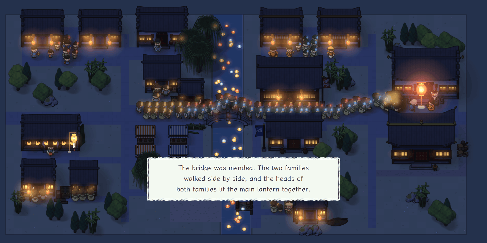

<p align="center"><b>English</b> · <a href="README_zh.md">简体中文</a></p>

<p align="center"><picture>
<source media="(prefers-color-scheme: dark)" srcset="docs/assets/banner-en-dark.png">
</picture></p>

<p align="center"><b>A river town is getting ready for its lantern festival. The talk of the town passes from person to person, and it changes on the way. For every line you hear, your notebook records who it came through.</b></p>

<p align="center"><b>Play in the browser: <a href="https://yyyjh1.github.io/lantern-eve/">https://yyyjh1.github.io/lantern-eve/</a></b></p>

<p align="center">
<a href="https://github.com/YYYJH1/lantern-eve/actions/workflows/ci.yml"></a>

<a href="LICENSE"></a>
</p>

<p align="center"><picture>
<source media="(prefers-color-scheme: dark)" srcset="docs/assets/play-en-dark.gif">
</picture><br>
<sub>The first day of five, from the opening page to the next morning. The red slip at the top names the next thing to do. After Start you meet six people, and the clan elder sends you to Granny Li to borrow the bamboo. A talk opens on a strip of paper along the bottom of the map, with four buttons and a row of hearts, and you can give the person a small gift. Granny Li refuses. You follow the rumour back from person to person, by way of the teahouse keeper, to Zhou's Clerk. In the notebook you set what the clerk saw beside what the town says, and find that the one does not prove the other. In the evening you set the talk straight in public at the teahouse. Everyone there says in their own words what they make of it, and Granny Li gives way. Li Da, who keeps the bamboo, promises to bring it. A note sums up the night. The next morning the Town Gazette is out. The bamboo lies at the bridge, and the ledger shows what the bridge needs and what has come.</sub></p>

Chengxi is a river town. A stretch of railing on its stone bridge has just fallen. The clan elder has brought you in from outside to run this year's lantern festival. On the night of the fifth day the Li and Zhou families are to carry their lanterns over the bridge together. Before then you have to mend the bridge, tell everyone how it broke, and make peace between the two families.

The elder walks you through the first day. You talk to people, follow a rumour back one person at a time, compare what you heard in your notebook, and go to the teahouse in the evening to set the talk straight in public.

<p align="center"><picture>
<source media="(prefers-color-scheme: dark)" srcset="docs/assets/notebook-en-dark.png">
</picture><br>
<sub>The notebook on the first day, just after two lines were compared. At the top of the left page is the line set against the claim, “Li Er was at the bridge last night”. Below it are the three ways two lines can relate, each with a small example, and then the result: that line shows only that Li Er was at the bridge, not that he broke the railing out of envy. The right page is the statement card, at 0 of 3. Under each blank are a few accounts to choose from, and beside each account is a tally in strokes of the character 正, one stroke for every note in the notebook that bears it out.</sub></p>

Twenty people live in the town. Each of them remembers what they have seen and heard, and has plans and old grudges of their own. They pass news to one another. You meet six of them at the start and the rest when you come across them. Everyone you have met goes into the people book. Each person has a row of hearts. Click it to see how things stand between you. The market has four small things each day, and you can give away one a day, to anyone you like. A talk has just four buttons: *Ask around*, *Ask a favour*, *Tell* and *Take your leave*. *Ask a favour* names on its button the one thing most worth asking this person for now, and the rest are under *Others*. The first time an action becomes useful, its button glows once and a small card says what it does.

The notebook also holds a statement card. Its three blanks are *How the bridge broke*, *What happened that night* and *Why people got it wrong*. You fill each blank with one of the accounts you have heard. From the evening of the fourth day you can make the statement in public.

The festival is on the night of the fifth day. Which way the lantern parade goes, whether the two families walk together and who lights the main lantern all follow from what you got done in the five days. After the festival comes the ending page, which draws how the rumour travelled through the town.

<p align="center"><picture>
<source media="(prefers-color-scheme: dark)" srcset="docs/assets/festival-en-dark.png">
</picture><br>
<sub>The festival night of a game that went as well as it could. The line at the bottom says how the night went: “The bridge was mended. The two families walked side by side, and the heads of both families lit the main lantern together.”</sub></p>

<p align="center"><picture>
<source media="(prefers-color-scheme: dark)" srcset="docs/assets/ending-en-dark.png">
</picture><br>
<sub>The ending page draws how the rumour travelled. There are two trees, each starting from someone who saw it, and the names of those two have a heavy frame. A line is one telling, and a dashed line carries a version that is not true. A numbered circle marks a telling that changed the story, and the list below says who told whom when it changed.</sub></p>

The town has sound. By day you hear the river, birds and the voices of the market. At night there are insects, and the watchman's clapper. When it rains you hear the rain, and the festival has drums and gongs and a tune. All of it is made in the browser as the game plays, and the menu can turn it off.

The townsfolk speak lines written for them, so a game needs no model and no key, and plays the same offline. If you like, the menu lets you connect a model of your own. Alibaba Bailian and DeepSeek take your own key, and Ollama runs on your own machine. The rules still decide what the townsfolk answer you, and the model only puts it in each person's own manner. The calls go from your browser straight to the provider. The key stays in the page, and goes into the browser's storage only when “remember on this device” is ticked. The model calls of a game stay within a budget, 3 yuan by default.

## Try it

The web version runs the whole town in your browser, with no game server and no key. The page shows Chinese or English as your browser does, and the menu can switch between them. To run it yourself you need Node 22.18 or later and [uv](https://docs.astral.sh/uv/). uv builds the core of the game for the browser. Vite prints the address to open. The game is made for a computer's browser, in a window of at least 1200 × 600. In a smaller window the opening page says so, and *Open anyway* starts the game all the same.

```bash
cd web
npm ci
npm run dev
```

The server host can run the town instead, under CPython. Build the client once, then start the server, which prints the address to open.

```bash
uv sync
npm --prefix web ci && npm --prefix web run build
uv run lantern-eve play
```

## Learn more

- [docs/development.md](docs/development.md): what each folder of the repository holds, how one core runs on two hosts, and the checks.
- [web/README.md](web/README.md): how the web client runs the core in a worker, and how to build and test it.
- [docs/models.md](docs/models.md): the models the townsfolk can speak through, and how to connect them in the browser and on the server host.
- [CONTRIBUTING.md](CONTRIBUTING.md): how to change the documents in two languages, and the checks to run.

## Credits

The game is under the MIT licence. It uses [Pyodide](https://pyodide.org) (MPL-2.0), [PixiJS](https://pixijs.com) (MIT) and [Preact](https://preactjs.com) (MIT). Its body text is set in LXGW WenKai and its titles in Ma Shan Zheng, both under the SIL Open Font License 1.1. [THIRD_PARTY.md](THIRD_PARTY.md) lists every component with its licence.
