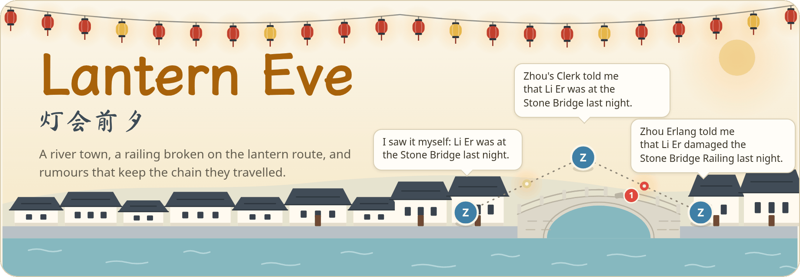
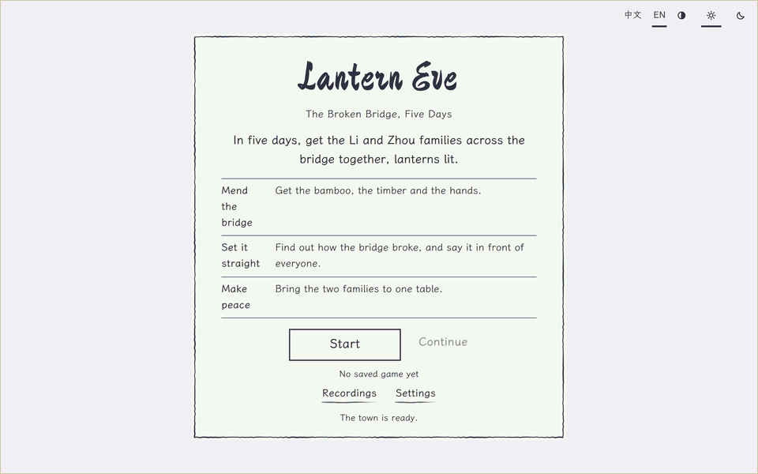
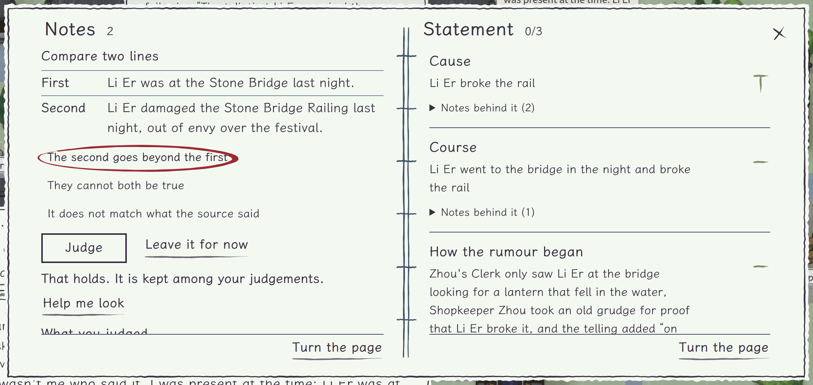
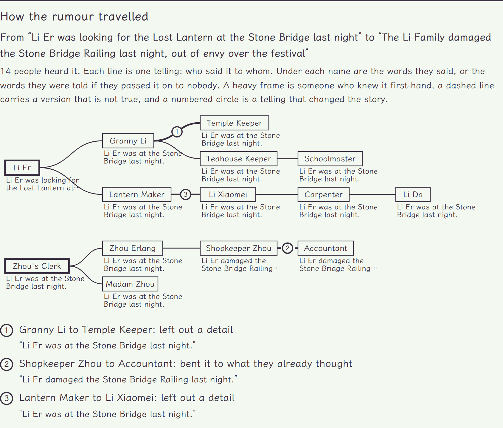

<p align="center"><b>English</b> · <a href="README_zh.md">简体中文</a></p>

<p align="center"><picture>
<source media="(prefers-color-scheme: dark)" srcset="docs/assets/banner-en-dark.png">
</picture></p>

<p align="center"><b>A river town getting ready for its lantern festival, where a rumour can change at every hop and your notebook remembers who told whom.</b></p>

<p align="center"><b>Play in the browser: <a href="https://yyyjh1.github.io/lantern-eve/">https://yyyjh1.github.io/lantern-eve/</a></b></p>

<p align="center">
<a href="https://github.com/YYYJH1/lantern-eve/actions/workflows/ci.yml"></a>

<a href="LICENSE"></a>
</p>

<p align="center"><picture>
<source media="(prefers-color-scheme: dark)" srcset="docs/assets/play-en-dark.gif">
</picture><br>
<sub>The first day of five, from the opening page to the next morning. The red slip at the top names the next thing to do. Granny Li refuses the bamboo in a talk shown as a strip of paper along the bottom of the map, the rumour is followed back to Zhou's Clerk, the manager judges in the notebook that what the clerk saw does not support what the town says, the teahouse hears it in the evening, Li Da promises the bamboo, and a lamp-lit note sums up the night. In the morning the Town Gazette is out, the bamboo lies at the bridge, and the ledger shows what the bridge takes and what has come.</sub></p>

A river town is getting ready for its lantern festival, and part of the railing on its stone bridge has just collapsed. You are the festival manager, and the clan elder walks you through the first day. Granny Li will not lend the bamboo while the town says her second son broke the bridge, so you follow the rumour back, from person to person, to Zhou's Clerk, who saw it, and judge in your notebook that what the clerk saw does not support what the town says. In the evening you say so in public at the teahouse, where each person makes up their own mind in their own words. Granny Li takes her objection back, Li Da promises the bamboo, and the next morning it lies at the bridge. Twenty townsfolk with memories, plans and grudges of their own pass news to one another, and every piece of news keeps the chain of people it went through, with what each of them changed on the way. When the festival is over, the ending page shows how the rumours really travelled.

The game lasts five days. The townsfolk speak lines written for them, so a game needs no model and no key and plays the same offline. If you like, the menu lets you pick a model of your own, from Alibaba Bailian or DeepSeek with your key or from Ollama on your machine, and the townsfolk word their answers to you themselves. The calls go from your browser straight to the provider, the key stays in the page unless you ask the page to remember it, and a game's model calls stay within a budget (3 yuan by default).

<p align="center"><picture>
<source media="(prefers-color-scheme: dark)" srcset="docs/assets/notebook-en-dark.png">
</picture><br>
<sub>The notebook once the pair is judged. The two lines stand one above the other on the left page, the manager has said how they stand, and the judgement is kept below, ready to be said in public at the teahouse in the evening. The statement card is the right page, still at 0 of 3.</sub></p>

<p align="center"><picture>
<source media="(prefers-color-scheme: dark)" srcset="docs/assets/ending-en-dark.png">
</picture><br>
<sub>The ending page, seed 7. A heavy frame is a person who knew the story first-hand, a dashed line carries a version that is not true, and a numbered circle marks a telling in which the story changed.</sub></p>

## Try it

The web client runs the world in the browser, with no game server and no key. The page follows the language of the browser, Chinese or English, and has a switch in the menu. It needs Node 22.18 or later and [uv](https://docs.astral.sh/uv/), which builds the world core for the browser. Vite prints the address to open. The game is made for a computer's browser, in a window of at least 1200 × 600: in a smaller window the opening page says so, and its *Open anyway* shows the game regardless.

```bash
cd web
npm ci
npm run dev
```

The server host runs the same world under CPython. Build the client once, then start the server, which prints the address to open:

```bash
uv sync
npm --prefix web ci && npm --prefix web run build
uv run lantern-eve play
```

## Learn more

- [docs/development.md](docs/development.md): the layout of the repository, the two hosts that run one core, and the checks.
- [web/README.md](web/README.md): the web client, how it runs the core in a worker, and how to build and test it.
- [docs/models.md](docs/models.md): the model providers that the townsfolk can speak through, in the browser and on the server host.
- [CONTRIBUTING.md](CONTRIBUTING.md): the documents in two languages and the checks.

## Credits

The game is under the MIT licence. It is built with [Pyodide](https://pyodide.org) (MPL-2.0), [PixiJS](https://pixijs.com) (MIT) and [Preact](https://preactjs.com) (MIT), and its body text is set in LXGW WenKai and its titles in Ma Shan Zheng (SIL Open Font License 1.1). [THIRD_PARTY.md](THIRD_PARTY.md) lists every component with its licence.
