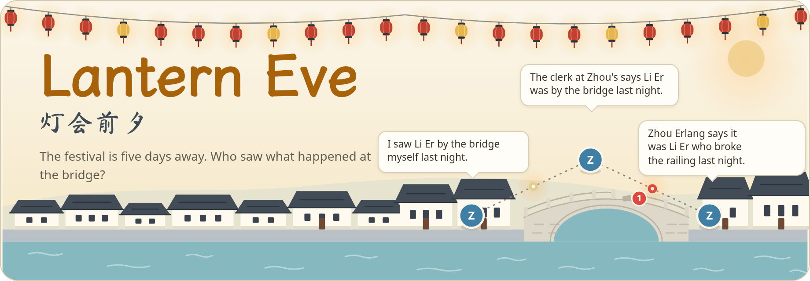
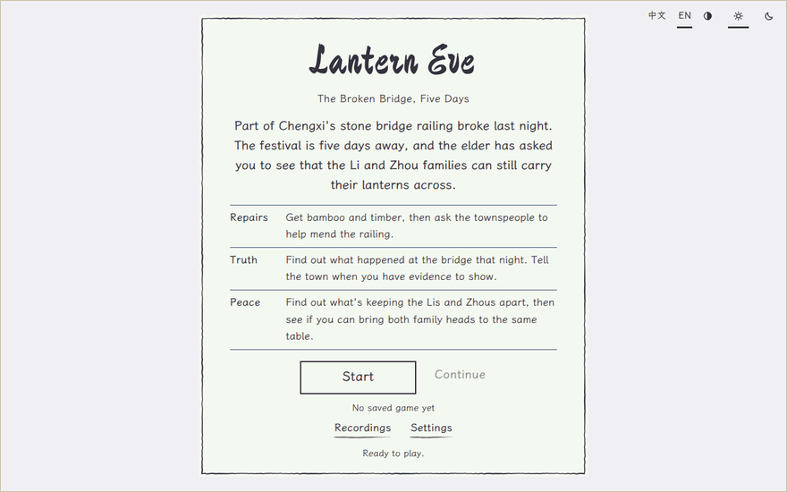
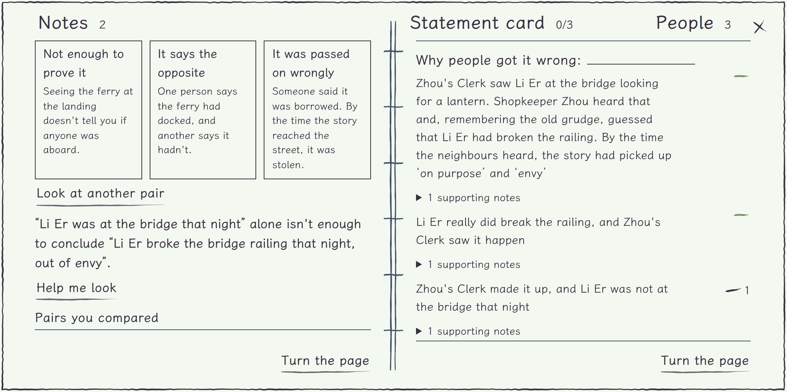
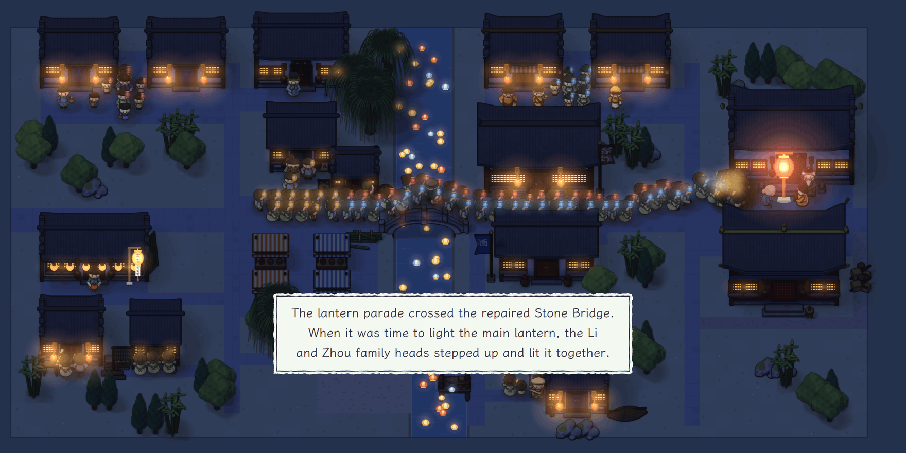
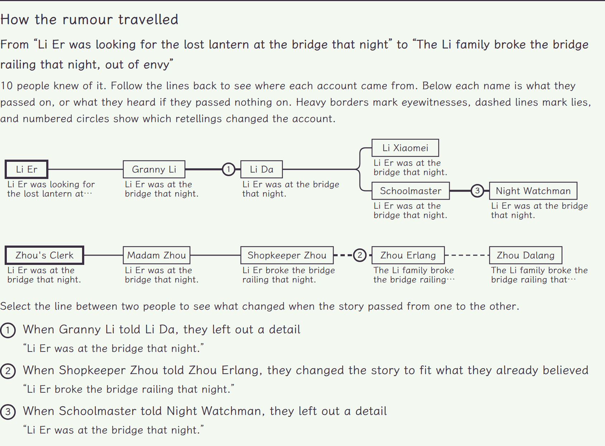

<p align="center"><b>English</b> · <a href="README_zh.md">简体中文</a></p>

<p align="center"><picture>
<source media="(prefers-color-scheme: dark)" srcset="docs/assets/banner-en-dark.png">
</picture></p>

<p align="center">There are five days until the lantern festival, and part of the bridge railing has come down. Someone saw Li Er there that night. A few doorways later, people are saying he broke it.</p>

<p align="center"><b><a href="https://yyyjh1.github.io/lantern-eve/">Play Lantern Eve in your browser</a></b></p>

<p align="center">
<a href="https://github.com/YYYJH1/lantern-eve/actions/workflows/ci.yml"></a>

<a href="LICENSE"></a>
</p>

<p align="center"><picture>
<source media="(prefers-color-scheme: dark)" srcset="docs/assets/play-en-dark.gif">
</picture><br>
<sub>The first day in play. Ask Granny Li for bamboo, hear Zhou's clerk give evidence at the teahouse, and see Li Da deliver the bamboo the next morning.</sub></p>

You're the new festival manager in Chengxi. The elder sends you to borrow bamboo from the Li family. Granny Li wants to know what you plan to tell the neighbours about her younger son. She heard the story from the teahouse keeper, who sends you to Zhou's clerk. The clerk can vouch for what they saw by the bridge.

Put the sighting beside the rumour in your notebook. When the teahouse fills up that evening, bring up the rumour and ask an eyewitness what they saw. If Granny Li gives way, find Li Da to arrange for the bamboo.

<p align="center"><picture>
<source media="(prefers-color-scheme: dark)" srcset="docs/assets/notebook-en-dark.png">
</picture><br>
<sub>Compare two accounts on the left. On the right, the strokes of 正 tally how many notes support each answer in your statement.</sub></p>

Twenty people live in Chengxi, with errands of their own and stories they've heard. The opening introduces six of them. Once you're in town, anyone you've greeted goes into the people book. In a conversation you can ask around, ask a favour, pass on a piece of news or take your leave. Click the hearts to see how you stand with someone. If you'd like to bring a gift, pick one at the market. You can give one a day.

Your notebook also holds a draft statement. Use the accounts you've collected to choose how the bridge broke, what happened that night and how the story went astray. From the fourth evening you can give the full statement in public.

What you get done over the five days determines which way the parade goes, whether the Li and Zhou families walk together and who lights the main lantern. After the festival, the ending shows who passed the rumour along to whom.

<p align="center"><picture>
<source media="(prefers-color-scheme: dark)" srcset="docs/assets/festival-en-dark.png">
</picture><br>
<sub>With the bridge repaired, the parade crosses the river and heads for the ancestral hall.</sub></p>

<p align="center"><picture>
<source media="(prefers-color-scheme: dark)" srcset="docs/assets/ending-en-dark.png">
</picture><br>
<sub>Each line is a retelling. A dashed line carries a false account. Follow the numbered circles to see where the story changed.</sub></p>

Listen for the river and the voices of the market during the day, or the watchman's clapper at night. The browser makes these sounds as you play. You can turn them off in the menu.

The dialogue comes with the game, which can run offline once its assets have loaded. To try model-written phrasing, connect Alibaba Bailian, DeepSeek or a local Ollama instance from the menu. The game rules still determine the facts in each answer. Requests go straight from your browser to the chosen provider. The browser saves your key only if you choose to remember it on this device. The default budget is 3 yuan per game.

## Try it

To run the web version locally, install Node 22.18 or later and [uv](https://docs.astral.sh/uv/). Open the address Vite prints. The game is laid out for a desktop browser. If the window is smaller than 1200 × 600, the opening page offers a way to continue. You can switch languages in the menu.

```bash
cd web
npm ci
npm run dev
```

You can also run the game on a CPython server. Build the client, start the server and open the address printed in the terminal.

```bash
uv sync
npm --prefix web ci && npm --prefix web run build
uv run lantern-eve play
```

## Learn more

- [docs/development.md](docs/development.md): what each folder of the repository holds, how one core runs on two hosts, and the checks.
- [web/README.md](web/README.md): how the web client runs the core in a worker, and how to build and test it.
- [docs/models.md](docs/models.md): the models the townsfolk can speak through, and how to connect them in the browser and on the server host.
- [CONTRIBUTING.md](CONTRIBUTING.md): how to change the documents in two languages, and the checks to run.

## Credits

The game is under the MIT licence. It uses [Pyodide](https://pyodide.org) (MPL-2.0), [PixiJS](https://pixijs.com) (MIT) and [Preact](https://preactjs.com) (MIT). Its body text is set in LXGW WenKai and its titles in Ma Shan Zheng, both under the SIL Open Font License 1.1. [THIRD_PARTY.md](THIRD_PARTY.md) lists every component with its licence.
