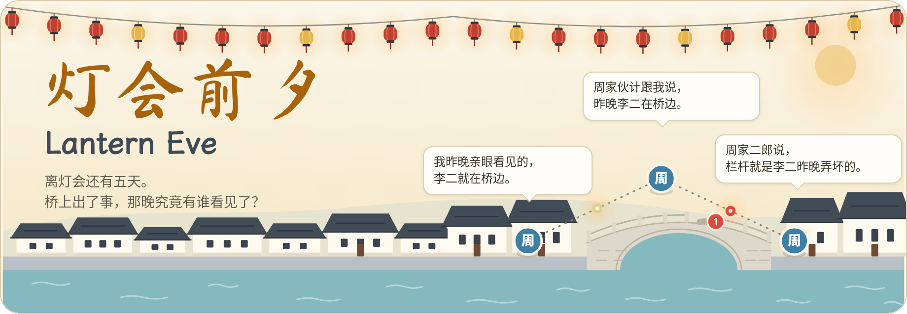
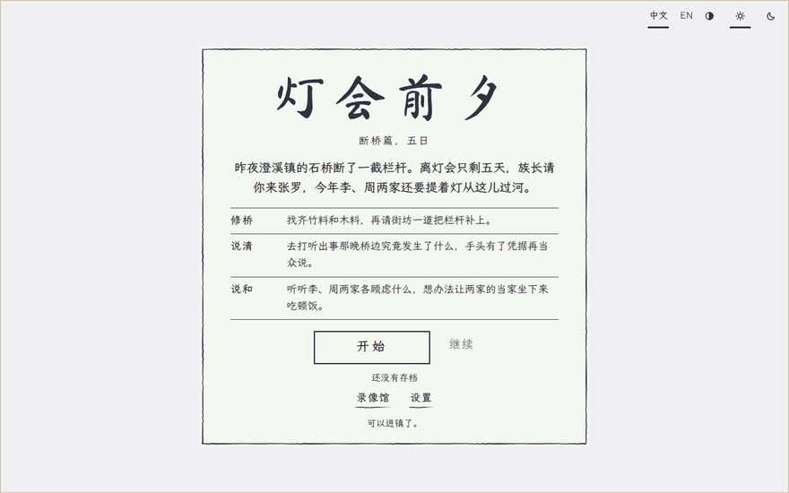
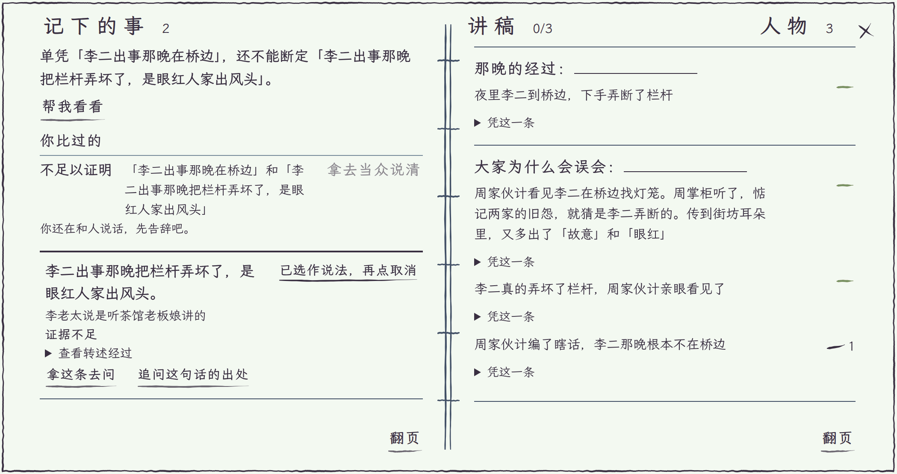
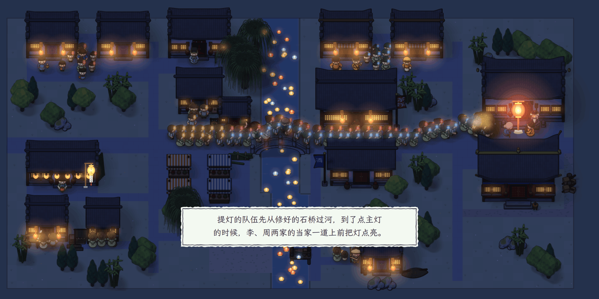
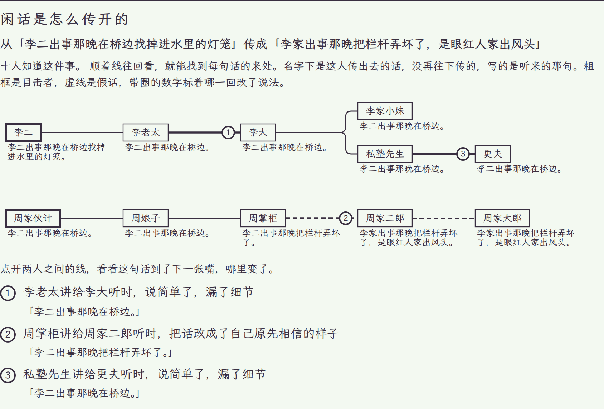

<p align="center"><a href="README.md">English</a> · <b>简体中文</b></p>

<p align="center"><picture>
<source media="(prefers-color-scheme: dark)" srcset="docs/assets/banner-zh-dark.png">
</picture></p>

<p align="center">离灯会还有五天，石桥的栏杆断了一截。有人说那晚在桥边见过李二。话传了几户，就变成了「李二把栏杆弄坏了」。</p>

<p align="center"><b><a href="https://yyyjh1.github.io/lantern-eve/">在浏览器里玩《灯会前夕》</a></b></p>

<p align="center">
<a href="https://github.com/YYYJH1/lantern-eve/actions/workflows/ci.yml"></a>

<a href="LICENSE"></a>
</p>

<p align="center"><picture>
<source media="(prefers-color-scheme: dark)" srcset="docs/assets/play-zh-dark.gif">
</picture><br>
<sub>第一天去李家借竹料，傍晚在茶馆请周家伙计作证。第二天一早，李大把竹料送到桥边。</sub></p>

你是澄溪镇新来的灯会总管。族长托你去李家借竹料。李老太一听，先问你打算怎么跟街坊说她家老二的事。她是从茶馆老板娘那儿听来的。老板娘让你去问周家伙计，伙计那晚在桥边见过李二。

在见闻簿里把传言和伙计的话对一对。傍晚茶馆聚了人，就能把传言拿出来说。伙计要是在场，也能当众说说那晚看见了什么。李老太松了口，再找李大商量什么时候送。

<p align="center"><picture>
<source media="(prefers-color-scheme: dark)" srcset="docs/assets/notebook-zh-dark.png">
</picture><br>
<sub>左页对照两条说法。右页是讲稿。「正」字有几笔，就有几条记录支持这个说法。</sub></p>

镇上有二十个人，各有自己的差事和听来的消息。开场先见到六位。进镇后，跟谁说过话，人物谱就会记下谁。跟人说话时，可以打听、请人帮忙、把消息说给对方听，也可以告辞。点人物的一排心能看交情。想送份礼，可以去集市挑，每天送一份。

见闻簿里还有一份讲稿。桥是怎么坏的、那晚出了什么事、闲话怎么传走样的，三处都要从查到的说法里选。到了第四天傍晚，你就能照着讲稿当众说明。

第五天晚上，游灯走哪条路、李周两家能不能一道走、谁来点主灯，都看你这几天办成了哪些事。散场后，结局页还能查街上的话是从谁传给谁的。

<p align="center"><picture>
<source media="(prefers-color-scheme: dark)" srcset="docs/assets/festival-zh-dark.png">
</picture><br>
<sub>桥修好以后，游灯队伍从石桥过河，往祠堂去。</sub></p>

<p align="center"><picture>
<source media="(prefers-color-scheme: dark)" srcset="docs/assets/ending-zh-dark.png">
</picture><br>
<sub>每条线是一次传话，虚线表示传的是错话。顺着编号往下找，可以看到哪一次变了样。</sub></p>

白天能听见河水和集市上的人声，夜里有打更的梆子。浏览器会随游戏合成声音，菜单里可以关。

游戏自带对白，资源加载后可以离线玩。想试用模型换一种说法，可以在菜单里接百炼、DeepSeek 或本机的 Ollama。答话用到的事实仍由游戏规则决定。浏览器直接向所选的提供方发请求，勾选「记在这台设备上」后才会保存密钥。每局默认预算 3 元。

## 试一试

本机运行网页版需要 Node 22.18 或更新版本和 [uv](https://docs.astral.sh/uv/)。启动后打开 Vite 打印的网址。游戏按电脑浏览器排版，窗口小于 1200×600 时会先提示，仍可选择进入。语言可在菜单里切换。

```bash
cd web
npm ci
npm run dev
```

也可以在 CPython 服务端运行游戏。先构建客户端，再启动服务端，打开终端显示的网址。

```bash
uv sync
npm --prefix web ci && npm --prefix web run build
uv run lantern-eve play
```

## 了解更多

- [docs/development_zh.md](docs/development_zh.md)：仓库里各目录放的是什么，同一份核心怎样跑在两种宿主上，要跑哪些检查。
- [web/README_zh.md](web/README_zh.md)：网页客户端怎样在 worker 里跑核心，怎样构建和测试。
- [docs/models_zh.md](docs/models_zh.md)：镇上的人能借哪些模型说话，在浏览器里和服务端上各怎么接。
- [CONTRIBUTING_zh.md](CONTRIBUTING_zh.md)：中英两份文档怎么改，要跑哪些检查。

## 致谢

游戏用 MIT 许可证发布。它用到了 [Pyodide](https://pyodide.org)（MPL-2.0）、[PixiJS](https://pixijs.com)（MIT）和 [Preact](https://preactjs.com)（MIT）。正文用霞鹜文楷，标题用马善政，这两款字体都用 SIL 开源字体许可证 1.1。每个组件用的是什么许可证，[THIRD_PARTY_zh.md](THIRD_PARTY_zh.md) 里都列着。
