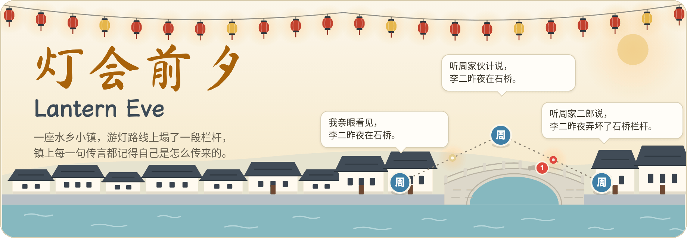
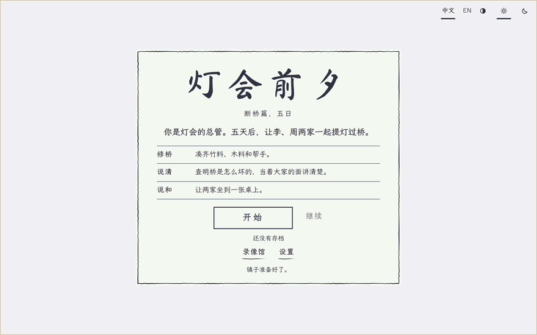
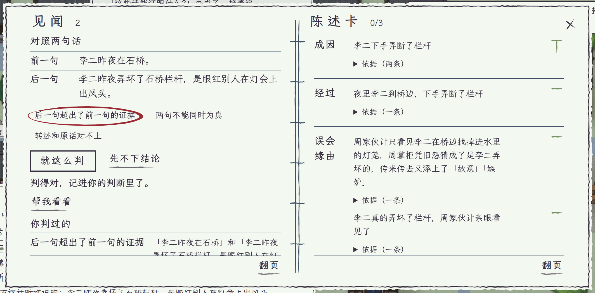
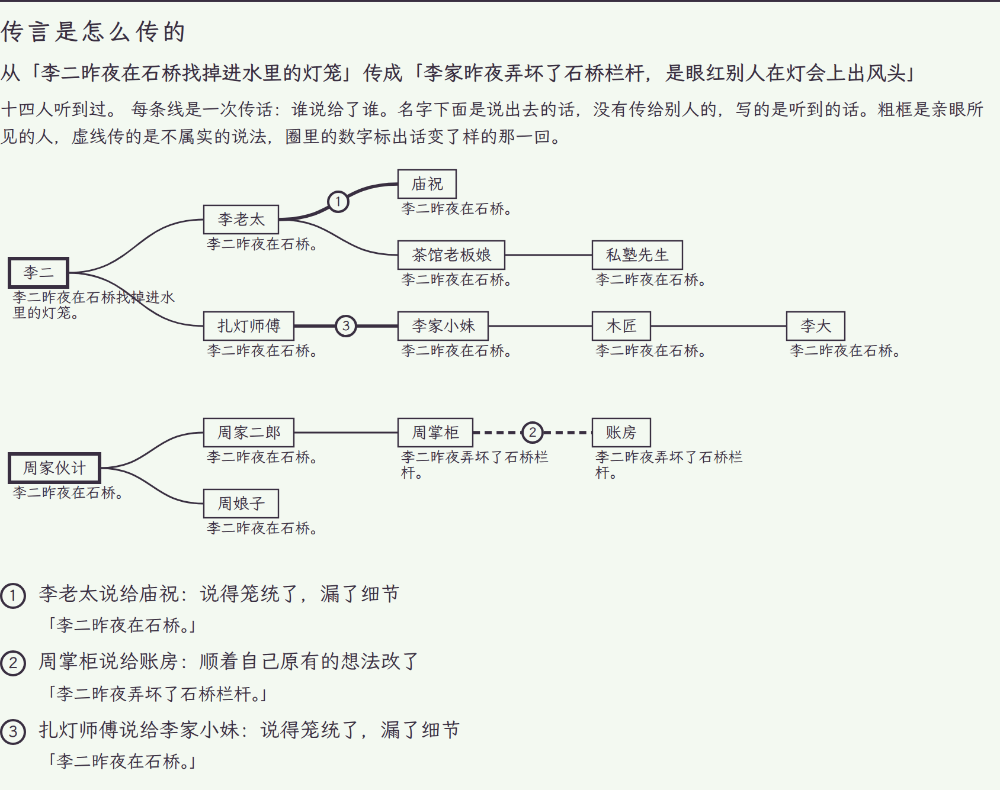

<p align="center"><a href="README.md">English</a> · <b>简体中文</b></p>

<p align="center"><picture>
<source media="(prefers-color-scheme: dark)" srcset="docs/assets/banner-zh-dark.png">
</picture></p>

<p align="center"><b>水乡小镇在筹备灯会，传言每传一跳都可能变样，你的见闻簿记得谁说给了谁。</b></p>

<p align="center"><b>在浏览器里玩：<a href="https://yyyjh1.github.io/lantern-eve/">https://yyyjh1.github.io/lantern-eve/</a></b></p>

<p align="center">
<a href="https://github.com/YYYJH1/lantern-eve/actions/workflows/ci.yml"></a>

<a href="LICENSE"></a>
</p>

<p align="center"><picture>
<source media="(prefers-color-scheme: dark)" srcset="docs/assets/play-zh-dark.gif">
</picture><br>
<sub>五天里的第一天，从开场页到次日早晨。顶上的红签写着眼下要办的事。李老太不肯借竹料，谈话是下方的一条纸带；传言一路追到周家伙计，总管在见闻簿里判定伙计看到的并不能证明镇上说的，傍晚在茶馆当众说清，李大答应了竹料，灯下的「夜里小结」把这一天收个尾。第二天一早《镇报》出了，竹料堆在桥边，账簿的修桥一页写着桥要什么、到了什么。</sub></p>

水乡小镇在筹备灯会，石桥的栏杆刚塌了一段。你是灯会总管，族长带你走完第一天。镇上都传李老太的二儿子毁了桥，她因此不肯借竹料，你顺着传言一个人一个人往回问，问到亲眼看见的周家伙计，再在见闻簿里判定：伙计看到的，并不能证明镇上说的。傍晚你在茶馆当众说清，在场的人各用自己的话说出怎么想，李老太收回阻拦，李大答应送竹料，第二天一早竹料就堆在桥边。镇上二十个有名有姓的人各有记忆、打算和积怨，彼此传话，每一条消息都记着它经过了谁、每一跳被改成了什么样。灯会过后，结局页会展示传言真正的走向。

游戏一共五天。镇上的人说的是事先写好的话，所以一局不需要模型，也不需要密钥，离线时玩起来也一样。想的话，可以在菜单里选一个自己的模型，阿里云百炼或 DeepSeek（用你自己的密钥），或者本机的 Ollama，镇上的人就会自己组织措辞来回答你。调用从你的浏览器直接发往提供方，密钥只留在页面里，除非你让页面记住它；一局的模型调用不会超出预算（默认 3 元）。

<p align="center"><picture>
<source media="(prefers-color-scheme: dark)" srcset="docs/assets/notebook-zh-dark.png">
</picture><br>
<sub>判完两句话的关系之后的见闻簿。左页上两句话一上一下摆着，总管说了它们是什么关系，判断记在下面，傍晚在茶馆就用它当众说清。右页是陈述卡，还是 0/3。</sub></p>

<p align="center"><picture>
<source media="(prefers-color-scheme: dark)" srcset="docs/assets/ending-zh-dark.png">
</picture><br>
<sub>种子 7 那一局的结局页。粗框是亲眼所见的人，虚线传的是不属实的说法，圈里的数字标出话变了样的那一回。</sub></p>

## 试一试

网页客户端在浏览器里跑整个世界，不用游戏服务端，也不用密钥。页面按浏览器的语言显示中文或英文，菜单里有切换开关。需要 Node 22.18 或更新版本和 [uv](https://docs.astral.sh/uv/)，uv 负责把世界核心打包给浏览器用。Vite 会打印要打开的地址。游戏为电脑的浏览器而做，窗口至少要 1200×600：窗口再小，开场页会说明，点「仍然打开」照样能进游戏。

```bash
cd web
npm ci
npm run dev
```

服务端宿主在 CPython 下运行同一个世界。先构建一次客户端，再启动服务端，它会打印要打开的地址：

```bash
uv sync
npm --prefix web ci && npm --prefix web run build
uv run lantern-eve play
```

## 了解更多

- [docs/development_zh.md](docs/development_zh.md)：仓库的目录，同一份核心的两种宿主，各项检查。
- [web/README_zh.md](web/README_zh.md)：网页客户端、它怎样在 worker 里运行核心，以及怎样构建和测试。
- [docs/models_zh.md](docs/models_zh.md)：镇上的人可以借以说话的模型提供方，浏览器里的和服务端宿主上的。
- [CONTRIBUTING_zh.md](CONTRIBUTING_zh.md)：双语文档和各项检查。

## 致谢

游戏采用 MIT 许可证。它用 [Pyodide](https://pyodide.org)（MPL-2.0）、[PixiJS](https://pixijs.com)（MIT）和 [Preact](https://preactjs.com)（MIT）构建，正文用霞鹜文楷，标题用马善政，两款字体都采用 SIL 开源字体许可证 1.1。[THIRD_PARTY_zh.md](THIRD_PARTY_zh.md) 列出每个组件和它的许可证。
