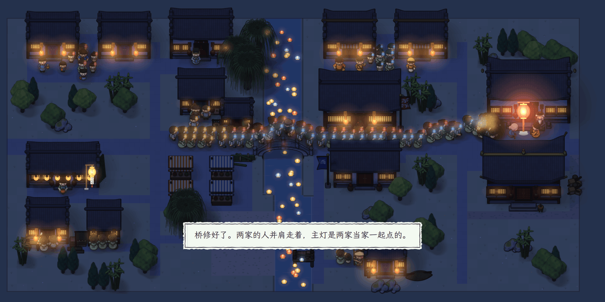

<p align="center"><a href="README.md">English</a> · <b>简体中文</b></p>

<p align="center"><picture>
<source media="(prefers-color-scheme: dark)" srcset="docs/assets/banner-zh-dark.png">
</picture></p>

<p align="center"><b>水乡小镇要办灯会了。镇上的闲话一个传一个，传着传着就走了样。你听来的每句话是经谁传过来的，见闻簿里都记着。</b></p>

<p align="center"><b>在浏览器里玩：<a href="https://yyyjh1.github.io/lantern-eve/">https://yyyjh1.github.io/lantern-eve/</a></b></p>

<p align="center">
<a href="https://github.com/YYYJH1/lantern-eve/actions/workflows/ci.yml"></a>

<a href="LICENSE"></a>
</p>

<p align="center"><picture>
<source media="(prefers-color-scheme: dark)" srcset="docs/assets/play-zh-dark.gif">
</picture><br>
<sub>五天里的第一天，从开场页到第二天早上。顶上的红签写着眼下要办的事。点了开始，先认识六个人。族长让你去找李老太借竹料。和人说话时，地图下方展开一条纸带，纸带上有四个按钮和一排心。谈话里还能送对方一样小东西。李老太不肯借。你顺着闲话一个个往回问，经茶馆老板娘问到周家伙计。在见闻簿里，你把伙计亲眼看见的那句和镇上传的那句放在一起比，看出前一句撑不起后一句。傍晚你在茶馆当众说清。在场的人各说各的看法，李老太松了口。管竹料的李大答应把竹料送来。夜里有一张小结。第二天一早，《镇报》出来了。竹料已经堆在桥边，账簿上记着修桥要多少、到了多少。</sub></p>

澄溪是个水乡小镇。镇上的石桥刚塌了一段栏杆。族长请你这个外乡人来当今年的灯会总管。第五天晚上，李、周两家要一起提灯过桥。在那之前，你要修好桥，把桥是怎么坏的当众说清，再让两家和好。

第一天由族长带着走。你找人说话，顺着一句闲话一个个往回问，在见闻簿里拿听来的话比一比，傍晚再去茶馆，当众把话说清。

<p align="center"><picture>
<source media="(prefers-color-scheme: dark)" srcset="docs/assets/notebook-zh-dark.png">
</picture><br>
<sub>第一天刚比完两句话的见闻簿。左页上面是拿来比的「李二昨晚在桥边」，下面是三种关系，每种带一个小例子。再往下是比的结果。这句只能说明李二昨晚在桥边，推不出镇上传的「李二昨晚把栏杆弄坏了，是眼红人家出风头」。右页是讲稿，还是 0/3。每个空下面列着几种说法。说法旁边用「正」字计数，见闻簿里每有一条对得上的话，就添一笔。</sub></p>

镇上有二十个人。每个人记着自己见过、听过的事，有自己的打算，也有旧怨。人和人之间还会传话。开局先认识其中六个，其余的见了面再认识。认识的人都会记进人物谱。每个人有一排心，点开就能看到你们的交情。集市上每天有四样小东西。你一天只能送出一样，不论送给谁。和人说话时只有四个按钮，「打听」「请帮忙」「说」「告辞」。「请帮忙」按钮上直接写着眼下最该请这个人办的那件事，别的事收在「别的」里。每样动作第一次用得上时，按钮会亮一下，再出一张小卡，说它能做什么。

见闻簿里还有一份讲稿。讲稿上有三个空，分别是「桥是怎么坏的」「那晚的经过」「大家为什么会误会」。每个空都从你听来的说法里挑一条填上。到了第四天傍晚，你就能照着讲稿当众说。

第五天晚上是灯会。游灯走哪条路，两家走不走在一起，主灯由谁来点，都看这五天办成了什么。灯会演完是结局页，上面画着闲话在镇上是怎么传开的。

<p align="center"><picture>
<source media="(prefers-color-scheme: dark)" srcset="docs/assets/festival-zh-dark.png">
</picture><br>
<sub>一局办得圆满时的灯会夜。画面底下写着这一夜是怎么过的：「桥修好了。两家的人并肩走着，主灯是两家当家一起点的。」</sub></p>

<p align="center"><picture>
<source media="(prefers-color-scheme: dark)" srcset="docs/assets/ending-zh-dark.png">
</picture><br>
<sub>结局页画出这句闲话是怎么传开的。图上有两棵树，各从一个亲眼看见的人画起。这两个人的名字都围着粗框。一条线是一次传话，虚线传的是假话。圈里的数字标着话传走样的那一回，下面逐条写着是谁说给谁时走的样。</sub></p>

镇上从早到晚都有声响。白天听得见河水、鸟叫和集市上的人声。夜里有虫鸣，还有打更的梆子。下雨时有雨声，灯会上有锣鼓，还有一支小曲。这些声音都由浏览器当场合成。不想听，可以在菜单里关掉。

镇上的人说的都是写好的话，所以玩一局用不着模型，也用不着密钥，断了网照样能玩。愿意的话，可以在菜单里接上自己的模型。阿里云百炼和 DeepSeek 用你自己的密钥，Ollama 跑在你自己的机器上。接上以后，镇上的人回你什么，照旧由规则来定，模型只把话换成这个人自己的口气。请求从你的浏览器直接发给提供方。密钥只留在页面里。只有勾了「记在这台设备上」，密钥才会存进浏览器。一局花在模型上的钱不会超出预算，预算默认是 3 元。

## 试一试

网页版在浏览器里跑整个小镇，不用游戏服务器，也不用密钥。页面按浏览器的语言显示中文或英文，菜单里也能换。在自己电脑上跑，要装 Node 22.18 或更新的版本，还要装 [uv](https://docs.astral.sh/uv/)。uv 负责把游戏的核心打成包，给浏览器用。Vite 启动后会打印出要打开的地址。游戏是给电脑的浏览器做的，窗口至少要 1200×600。窗口小了，开场页会提示，点「仍然打开」照样能玩。

```bash
cd web
npm ci
npm run dev
```

也可以让服务端来跑小镇，服务端用的是 CPython。先把客户端构建一次，再启动服务端，服务端会打印出要打开的地址。

```bash
uv sync
npm --prefix web ci && npm --prefix web run build
uv run lantern-eve play
```

## 了解更多

- [docs/development_zh.md](docs/development_zh.md)：仓库里各目录放的是什么，同一份核心怎样跑在两种宿主上，要跑哪些检查。
- [web/README_zh.md](web/README_zh.md)：网页客户端怎样在 worker 里跑核心，怎样构建和测试。
- [docs/models_zh.md](docs/models_zh.md)：镇上的人能借哪些模型说话，在浏览器里和服务端上各怎么接。
- [CONTRIBUTING_zh.md](CONTRIBUTING_zh.md)：中英两份文档怎么改，要跑哪些检查。

## 致谢

游戏用 MIT 许可证发布。它用到了 [Pyodide](https://pyodide.org)（MPL-2.0）、[PixiJS](https://pixijs.com)（MIT）和 [Preact](https://preactjs.com)（MIT）。正文用霞鹜文楷，标题用马善政，这两款字体都用 SIL 开源字体许可证 1.1。每个组件用的是什么许可证，[THIRD_PARTY_zh.md](THIRD_PARTY_zh.md) 里都列着。
