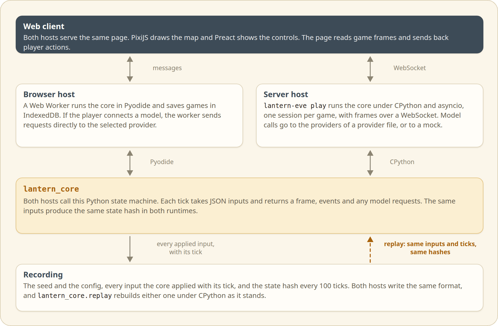

<p align="center"><b>English</b> · <a href="development_zh.md">简体中文</a></p>

# Development

## One core, two hosts

<p align="center"><picture>
<source media="(prefers-color-scheme: dark)" srcset="assets/architecture-en-dark.png">
</picture></p>

`lantern_core` is the game's state machine. Each tick takes JSON inputs and returns JSON outputs. The host handles clocks, files and network access. It numbers state-changing inputs as they arrive, including player actions, model replies and pauses. A replay sends those inputs back in order. The state uses integers, strings, booleans, `null`, lists and objects. Given the same inputs, CPython and Pyodide produce the same SHA-256 at every tick.

The browser host runs the core in Pyodide inside a module worker. The server host uses CPython and asyncio. The docstring in `core/lantern_core/api.py` defines the interface for both.

`lantern-eve play` runs the server host on `127.0.0.1`, serves the built page and opens one session per game. Each session numbers incoming inputs, steps the core at a fixed interval, passes model requests to the transport and records the inputs the core applied. The page connects over WebSocket using the protocol documented in `host_server/lantern_eve/protocol.py`. Replays go to `runs/` in the browser host format, ready for `lantern_core.replay.rebuild`. See the [web client guide](../web/README.md) for connection instructions.

## Layout

| Path | What is there |
|---|---|
| `core/` | `lantern_core`, the world. Standard library only, so the same wheel runs under CPython and Pyodide |
| `host_server/` | `lantern_eve`, the server host: asyncio, model transports, WebSocket frames, batch runs |
| `web/` | the web client (TypeScript, PixiJS, Preact) and the browser host |
| `configs/` | `providers.example.toml`, an example provider file for the server host (see [models.md](models.md)) |
| `content/` | the closed tables of predicates and motives, the sentences the townsfolk say and the words the checker of a model's reply knows, the entities, the scripts, the lines of each person in two languages, the map of the town and its cast, the prompts for the models, and their compiled JSON |
| `tools/` | `check_content.py`, which validates the content and compiles it, with the `*_content.py` modules beside it; `sprite-kit/`, which bakes the sprites of the town map and the objects in the corner of the page (see [tools/sprite-kit/README.md](../tools/sprite-kit/README.md)); `fonts/`, which cuts the fonts of the page down to the characters of the game (see [tools/fonts/README.md](../tools/fonts/README.md)); `ink_ui/`, which draws the paper edges and the brush marks of the interface (see [tools/ink_ui/README.md](../tools/ink_ui/README.md)); `readme_assets/`, which makes the pictures of the two READMEs (see [tools/readme_assets/README.md](../tools/readme_assets/README.md)); `bots/`, rule-based managers that play whole games headless, and `balance.py` and `follow_report.py`, which run them and tally how the games end |
| `tests/` | pytest for the core, the content and the hosts, and the cross-host hash check |
| `docs/` | the documents, and the pictures they show in `docs/assets/` |

## Checks

```bash
uv sync
npm ci --prefix tests/cross_host
uv run ruff check .
uv run ruff format --check .
uv run python tools/check_content.py --check
uv run python tools/fonts/build.py --check
uv run pytest -q -n 8
uv run lantern-eve batch --seeds 1-3 --ticks 500
npm --prefix web ci
npm --prefix web exec -- playwright install chromium
npm --prefix web run test:e2e
```

`pytest -n 8` runs eight processes via pytest-xdist. The cross-host tests require `npm ci --prefix tests/cross_host`, and the built-page test requires `web/dist`. pytest skips each check when its prerequisite is missing.

`lantern-eve batch` plays the demo scenario `m0` without a page. Use `--scenario bridge` to play Chengxi. The command prints the last tick and state hash for each seed. Repeating a seed produces the same output.

CI runs on pushes to `main` and on pull requests. You can also start it from the Actions tab, including on forks, where dispatch is manual. Python 3.12 and 3.14 jobs run Ruff, content and font checks, and pytest. The Node 22 and Pyodide 314 job treats a skipped cross-host comparison as a failure. Chromium tests run in groups of similar runtime and also have a separate weekly run. See [browser test groups](../web/README.md#tests).
