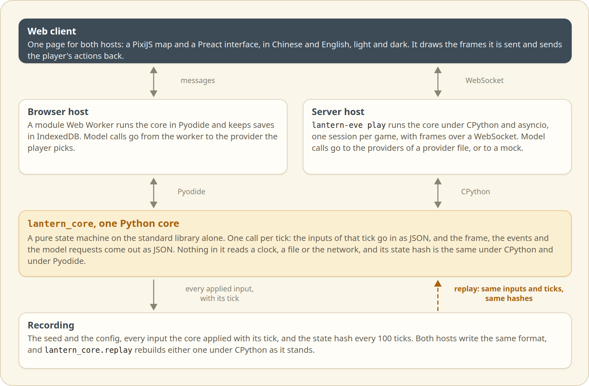

<p align="center"><b>English</b> · <a href="development_zh.md">简体中文</a></p>

# Development

## One core, two hosts

<p align="center"><picture>
<source media="(prefers-color-scheme: dark)" srcset="assets/architecture-en-dark.png">
</picture></p>

The world is `lantern_core`, a pure state machine: a call takes the inputs of one tick as JSON and returns that tick's outputs as JSON, and nothing in the core reads a clock, a file or the network. Every input that can change the world (a player action, a model result, a pause) is numbered by the host when it arrives and recorded, so a replay reproduces the game tick for tick. The state holds no floats, only integers, strings, booleans and null in lists and objects, and its SHA-256 is the same under CPython and under Pyodide.

The browser host runs the core in Pyodide inside a module worker. The server host runs it under CPython with asyncio. Both use the contract in the docstring of `core/lantern_core/api.py`.

The `lantern-eve` command runs the server host. `lantern-eve play` serves the built web client on 127.0.0.1 and runs one session per game. A session runs the loop of the browser host in Python: it numbers inputs on receipt, steps the core on a fixed-timestep accumulator, hands model requests to a transport and records what the core applied. The page talks to it over a WebSocket, with the browser host's messages plus a few of its own that `host_server/lantern_eve/protocol.py` documents. Each game's replay goes to `runs/` in the browser host's format, so `lantern_core.replay.rebuild` reads it as it stands. [web/README.md](../web/README.md) says how to run the web client against it.

## Layout

| Path | What is there |
|---|---|
| `core/` | `lantern_core`, the world. Standard library only, so the same wheel runs under CPython and Pyodide |
| `host_server/` | `lantern_eve`, the server host: asyncio, model transports, WebSocket frames, batch runs |
| `web/` | the web client (TypeScript, PixiJS, Preact) and the browser host |
| `configs/` | `providers.example.toml`, an example provider file for the server host (see [models.md](models.md)) |
| `content/` | the closed predicate and motive tables, entities, scripts, the lines the townsfolk say in two languages, the map of the town and its cast, the prompts for the models, and their compiled JSON |
| `tools/` | `check_content.py`, which validates the content and compiles it; `sprite-kit/`, which bakes the sprites of the town map and the objects in the corner of the page (see [tools/sprite-kit/README.md](../tools/sprite-kit/README.md)); `fonts/`, which cuts the fonts of the page down to the characters of the game (see [tools/fonts/README.md](../tools/fonts/README.md)); `ink_ui/`, which draws the paper edges and the brush marks of the interface (see [tools/ink_ui/README.md](../tools/ink_ui/README.md)); `readme_assets/`, which makes the pictures of the two READMEs (see [tools/readme_assets/README.md](../tools/readme_assets/README.md)); `bots/`, rule-based managers that play whole games headless, and `balance.py` and `follow_report.py`, which run them and tally how the games end |
| `tests/` | pytest for the core, the content and the hosts, and the cross-host hash check |
| `docs/` | the documents, and the pictures they show in `docs/assets/` |

## Checks

```bash
uv sync
npm ci --prefix tests/cross_host
uv run ruff check .
uv run ruff format --check .
uv run python tools/check_content.py --check
uv run python tools/fonts/build.py --check
uv run pytest -q -n 8
uv run lantern-eve batch --seeds 1-3 --ticks 500
npm --prefix web ci
npm --prefix web exec -- playwright install chromium
npm --prefix web run test:e2e
```

`-n 8` runs the tests in eight processes (pytest-xdist). pytest skips the cross-host tests until `npm ci --prefix tests/cross_host` has run, and the check of the built page until `web/dist` is built. `lantern-eve batch` plays the seeds of the demo world `m0` headless (`--scenario bridge` plays the town), one call of the core per tick, and prints one line per seed with the final tick and the state hash. The same seeds print the same lines on every run.

CI runs on every push to main and on every pull request, and can be started by hand from the Actions tab. Once a week the browser tests run alone. It runs ruff, the content and font checks and pytest on 3.12 and 3.14, the cross-host check under Node 22 and Pyodide 314 (a skipped run fails), and the web build and browser tests in Chromium.
