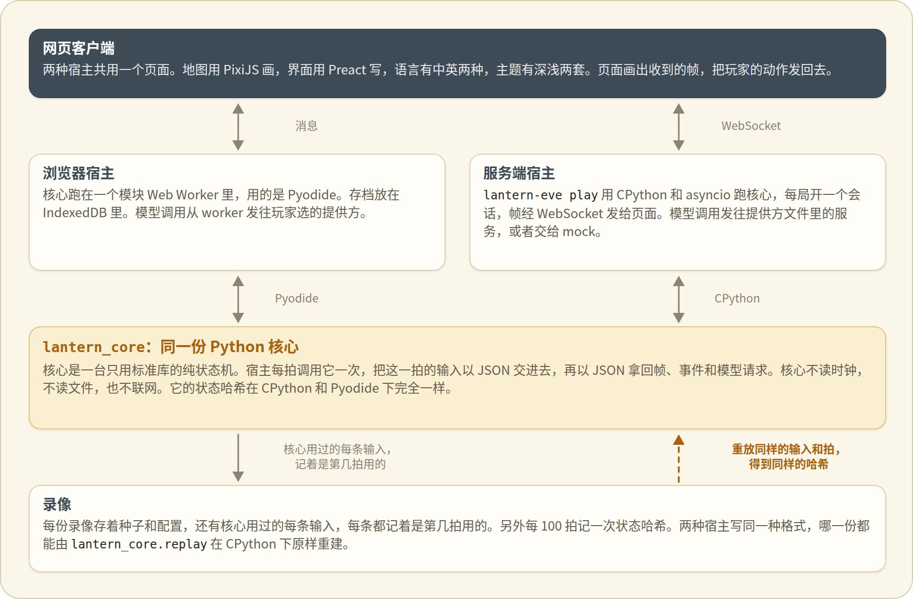

<p align="center"><a href="development.md">English</a> · <b>简体中文</b></p>

# 开发说明

## 一份核心，两种宿主

<p align="center"><picture>
<source media="(prefers-color-scheme: dark)" srcset="assets/architecture-zh-dark.png">
</picture></p>

`lantern_core` 就是游戏世界本身，是一台纯状态机。宿主每拍调用它一次，用 JSON 把这一拍的输入交进去，拿回的输出也是 JSON。核心不读时钟，不读文件，也不联网。凡是会改变世界的输入，比如玩家的动作、模型的结果、暂停，一到宿主就编上号记下来，所以录像能一拍不差地重放出这一局。状态里没有浮点数，只有整数、字符串、布尔值和 null，装在列表和对象里。状态的 SHA-256 在 CPython 和 Pyodide 下完全一样。

浏览器宿主在模块 worker 里用 Pyodide 跑核心。服务端宿主用 CPython 加 asyncio 跑核心。两边守的是同一份约定，写在 `core/lantern_core/api.py` 的文档字符串里。

`lantern-eve` 命令跑的是服务端宿主。`lantern-eve play` 在 127.0.0.1 上起一个服务，把构建好的网页客户端发给浏览器，每局开一个会话。会话用 Python 跑浏览器宿主那一套循环。它收到输入就编号，用定步长累加器推进核心，把模型请求交给传输层，再记下核心用了哪些输入。页面经 WebSocket 和它通信，用的是浏览器宿主的那些消息，外加几条它自己的，都写在 `host_server/lantern_eve/protocol.py` 里。每局的录像按浏览器宿主的格式写进 `runs/`，所以 `lantern_core.replay.rebuild` 能原样读它。怎样让网页客户端连上服务端宿主，见 [web/README_zh.md](../web/README_zh.md)。

## 目录

| 路径 | 里面是什么 |
|---|---|
| `core/` | `lantern_core`，也就是世界本身。只用标准库，所以同一个 wheel 在 CPython 和 Pyodide 里都能跑 |
| `host_server/` | `lantern_eve`，即服务端宿主：asyncio，模型的传输层，经 WebSocket 推帧，批量跑局 |
| `web/` | 网页客户端（TypeScript、PixiJS、Preact）和浏览器宿主 |
| `configs/` | `providers.example.toml`，服务端宿主的提供方文件示例（见 [models_zh.md](models_zh.md)） |
| `content/` | 谓词和动机两张封闭的表，镇上的人说话用的句子，检查模型回话时认的词，实体，剧本，每个人中英两种语言的台词，小镇的地图和人物表，给模型的提示词，以及它们编译出的 JSON |
| `tools/` | `check_content.py` 校验内容并编译，旁边的几个 `*_content.py` 模块是它的帮手。`sprite-kit/` 烘焙小镇地图上的精灵和页面角落里的物件（见 [tools/sprite-kit/README_zh.md](../tools/sprite-kit/README_zh.md)）。`fonts/` 把页面的字体裁到只剩游戏用得到的字（见 [tools/fonts/README_zh.md](../tools/fonts/README_zh.md)）。`ink_ui/` 画界面的纸边和笔画记号（见 [tools/ink_ui/README_zh.md](../tools/ink_ui/README_zh.md)）。`readme_assets/` 做两份 README 里的配图（见 [tools/readme_assets/README_zh.md](../tools/readme_assets/README_zh.md)）。`bots/` 是照规则办事的总管，能无头跑完整局，`balance.py` 和 `follow_report.py` 让它们去跑，再统计各局怎么收场 |
| `tests/` | 核心、内容和两种宿主的 pytest，以及跨宿主的哈希比对 |
| `docs/` | 文档，以及文档里的配图（在 `docs/assets/`） |

## 检查

```bash
uv sync
npm ci --prefix tests/cross_host
uv run ruff check .
uv run ruff format --check .
uv run python tools/check_content.py --check
uv run python tools/fonts/build.py --check
uv run pytest -q -n 8
uv run lantern-eve batch --seeds 1-3 --ticks 500
npm --prefix web ci
npm --prefix web exec -- playwright install chromium
npm --prefix web run test:e2e
```

`-n 8` 让测试分成八个进程并行跑（pytest-xdist）。没跑过 `npm ci --prefix tests/cross_host`，pytest 会跳过跨宿主的测试。`web/dist` 没构建出来，pytest 也会跳过检查构建产物的那一项。`lantern-eve batch` 无头跑演示世界 `m0` 的这几个种子（`--scenario bridge` 跑的是小镇），每拍调用一次核心。它给每个种子打印一行，写着最后一拍的拍号和状态哈希。同样的种子，每次打印出的行都一样。

每次推送到 main 和每个 pull request 都会跑 CI，在 Actions 页面也能手动启动。在 fork 里，CI 的任务只在手动启动时才跑。每周还会单独跑一次浏览器测试。CI 在 Python 3.12 和 3.14 上跑 ruff、内容检查、字体检查和 pytest，在 Node 22 和 Pyodide 314 上跑跨宿主比对，比对被跳过也算失败。CI 还在 Chromium 里跑网页构建和浏览器测试。浏览器测试分成用时差不多的几份，每台运行机跑一份（见 [web/README_zh.md](../web/README_zh.md)）。
