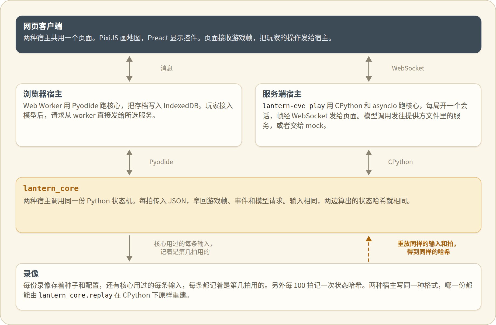

<p align="center"><a href="development.md">English</a> · <b>简体中文</b></p>

# 开发说明

## 一份核心，两种宿主

<p align="center"><picture>
<source media="(prefers-color-scheme: dark)" srcset="assets/architecture-zh-dark.png">
</picture></p>

`lantern_core` 是游戏的状态机。宿主每拍把 JSON 输入交给核心，再接收这一拍的 JSON 输出。时钟、文件和网络由宿主管理。玩家操作、模型结果、暂停等会改变状态的输入，宿主在收到时编号并记进录像。回放按这个顺序重新交给核心。状态由整数、字符串、布尔值、`null`、列表和对象组成，同一局在 CPython 和 Pyodide 下逐拍得到相同的 SHA-256。

浏览器宿主在模块 worker 里通过 Pyodide 运行核心。服务端宿主使用 CPython 和 asyncio。两种宿主的接口约定见 `core/lantern_core/api.py` 的文档字符串。

`lantern-eve play` 在 `127.0.0.1` 运行服务端宿主，提供构建好的网页，并为每局开一个会话。会话给收到的输入编号，用固定步长推进核心，把模型请求交给传输层，并记录核心实际采用的输入。页面经 WebSocket 和会话通信，消息格式见 `host_server/lantern_eve/protocol.py`。录像写入 `runs/`，格式与浏览器宿主一致，可以直接交给 `lantern_core.replay.rebuild`。连接方式见 [网页客户端说明](../web/README_zh.md)。

## 目录

| 路径 | 里面是什么 |
|---|---|
| `core/` | `lantern_core`，也就是世界本身。只用标准库，所以同一个 wheel 在 CPython 和 Pyodide 里都能跑 |
| `host_server/` | `lantern_eve`，即服务端宿主：asyncio，模型的传输层，经 WebSocket 推帧，批量跑局 |
| `web/` | 网页客户端（TypeScript、PixiJS、Preact）和浏览器宿主 |
| `configs/` | `providers.example.toml`，服务端宿主的提供方文件示例（见 [models_zh.md](models_zh.md)） |
| `content/` | 谓词和动机两张封闭的表，镇上的人说话用的句子，检查模型回话时认的词，实体，剧本，每个人中英两种语言的台词，小镇的地图和人物表，给模型的提示词，以及它们编译出的 JSON |
| `tools/` | `check_content.py` 校验内容并编译，旁边的几个 `*_content.py` 模块是它的帮手。`sprite-kit/` 烘焙小镇地图上的精灵和页面角落里的物件（见 [tools/sprite-kit/README_zh.md](../tools/sprite-kit/README_zh.md)）。`fonts/` 把页面的字体裁到只剩游戏用得到的字（见 [tools/fonts/README_zh.md](../tools/fonts/README_zh.md)）。`ink_ui/` 画界面的纸边和笔画记号（见 [tools/ink_ui/README_zh.md](../tools/ink_ui/README_zh.md)）。`readme_assets/` 做两份 README 里的配图（见 [tools/readme_assets/README_zh.md](../tools/readme_assets/README_zh.md)）。`bots/` 是照规则办事的总管，能无头跑完整局，`balance.py` 和 `follow_report.py` 让它们去跑，再统计各局怎么收场 |
| `tests/` | 核心、内容和两种宿主的 pytest，以及跨宿主的哈希比对 |
| `docs/` | 文档，以及文档里的配图（在 `docs/assets/`） |

## 检查

```bash
uv sync
npm ci --prefix tests/cross_host
uv run ruff check .
uv run ruff format --check .
uv run python tools/check_content.py --check
uv run python tools/fonts/build.py --check
uv run pytest -q -n 8
uv run lantern-eve batch --seeds 1-3 --ticks 500
npm --prefix web ci
npm --prefix web exec -- playwright install chromium
npm --prefix web run test:e2e
```

`pytest -n 8` 用 pytest-xdist 开八个进程。跨宿主测试需要先运行 `npm ci --prefix tests/cross_host`，页面产物测试需要先构建 `web/dist`。各自的依赖缺失时，pytest 会跳过对应测试。

`lantern-eve batch` 默认跑演示场景 `m0`，加 `--scenario bridge` 可跑澄溪镇。批跑不需要打开页面。命令为每个种子打印最后的拍号和状态哈希，同一个种子重复运行的输出应当一致。

推送到 `main` 或打开 pull request 时会运行 CI，也可以在 Actions 页面手动启动。Fork 里的工作流只手动运行。Python 3.12 和 3.14 上检查 Ruff、内容、字体和 pytest。Node 22 和 Pyodide 314 上做跨宿主比对，跳过比对也算失败。浏览器测试使用 Chromium，按耗时分给多台运行机，每周还会独立跑一轮。[浏览器测试清单](../web/README_zh.md#测试)
